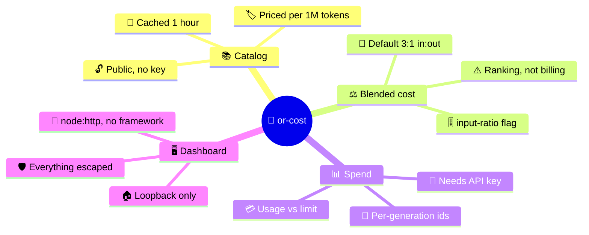
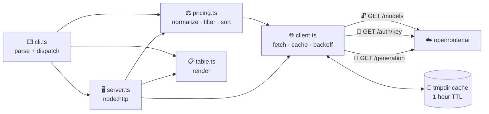
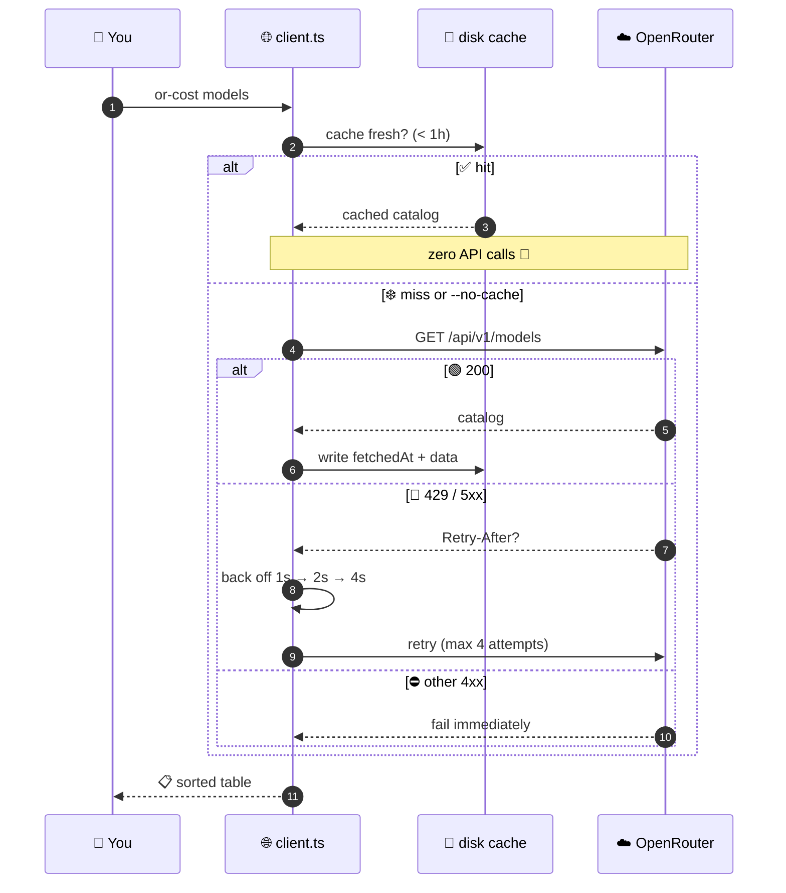

<div align="center">

```
                                    __
   ____  _____      _____  ____ ___/ /_
  / __ \/ ___/_____/ ___/ / __ \/ ___/ __/
 / /_/ / /  /_____/ /__  / /_/ (__  ) /_
 \____/_/         \___/  \____/____/\__/

     what does it cost, and what did I spend?
```

# 💸 or-cost

**OpenRouter model cost comparison + spend visibility — CLI & local dashboard**

[](https://github.com/shoemoney/or-cost/actions/workflows/ci.yml)
[](LICENSE)
[](https://nodejs.org)
[](tsconfig.json)
[](package.json)
[](test/)

</div>

---

`or-cost` answers two questions: 💰 **what does each model on OpenRouter actually cost**, and 📊 **what has my key spent**.

The catalog side — comparing prices across every model OpenRouter lists, ranking them, estimating a workload — needs **no API key at all**, because `GET /api/v1/models` is a public endpoint. Only `spend` talks to an authenticated endpoint. ✨

## 🧭 Table of contents

| 🚀 Get going | 📖 Understand | 🔒 Trust |
|---|---|---|
| [Install](#-install) · [Usage](#️-usage) | [Blended cost](#️-how-blended-cost-works) · [Architecture](#️-architecture) | [Security](#-security) · [Rate limits](#-rate-limits--caching) |
| [Sample output](#-sample-output) | [Why this matters](#-why-this-matters) | [Development](#-development) · [License](#-license) |

## 🤔 Why

| Question | Without `or-cost` | With `or-cost` |
|---|---|---|
| 💵 What does this model cost? | Two prices per model, in a web table, per provider | One blended number, sorted, in your terminal |
| 🧮 What will *this workload* cost? | Spreadsheet + mental math | `or-cost estimate 100000 20000` |
| 📉 What has my key drawn down? | Log into the dashboard | `or-cost spend` |
| 🔑 Do I need credentials to compare prices? | — | **No.** Catalog is public |
| 📦 What am I installing? | — | **Zero runtime dependencies** |

## 🧠 Core concepts



## 🏗️ Architecture



<details>
<summary>🔁 <b>How a catalog request actually flows</b> (cache + rate-limit handling)</summary>



</details>

## 📦 Install

```bash
git clone https://github.com/shoemoney/or-cost.git
cd or-cost
npm install
npm run build
node dist/cli.js models --limit 12
```

🔗 Or link it onto your PATH so the `or-cost` bin works anywhere:

```bash
npm link
or-cost models --provider anthropic
```

🔑 An API key is only needed for `spend` (and the spend panel of `serve`):

```bash
export OPENROUTER_API_KEY=sk-or-...
```

## ⌨️ Usage

### 📚 `models` — compare prices across the catalog

```bash
or-cost models                                  # cheapest 30 by blended cost
or-cost models --provider anthropic             # one author/org
or-cost models --search sonnet                  # substring match on id or name
or-cost models --sort output --desc             # blended | input | output | context | name
or-cost models --max-price 2 --limit 0          # everything under $2/1M blended, no row cap
or-cost models --free                           # only $0 models
or-cost models --input-ratio 1                  # weight input and output equally
or-cost models --no-cache --json                # skip the disk cache, emit JSON
```

### 🧮 `estimate` — cost of a concrete workload

Takes prompt tokens and completion tokens as positional arguments, then applies the same filters as `models`.

```bash
or-cost estimate 100000 20000                   # 100K in, 20K out, cheapest 30 (--limit 0 for all)
or-cost estimate 100000 20000 --provider openai --limit 10
or-cost estimate 8000 2000 --max-price 5 --json
```

### 📊 `spend` — key usage and per-generation breakdown

Requires `OPENROUTER_API_KEY`. Prints key label, usage, credit limit, remaining, and tier.

> ⚠️ OpenRouter has **no public "list all my generations" endpoint**, so the per-model breakdown is built from generation ids you already hold (your own logs, or the `id` on a chat completion response) and pass with `--ids`.

```bash
or-cost spend                                   # key usage summary only
or-cost spend --ids gen-abc,gen-def             # + per-model breakdown
or-cost spend --json
```

### 🖥️ `serve` — local dashboard

Catalog at `/`, spend at `/spend`, model list as JSON at `/api/models`. Binds `127.0.0.1` only; no key required to browse the catalog.

```bash
or-cost serve                                   # http://localhost:7777
or-cost serve --port 8080
```

### 🎛️ Flag reference

| Flag | Applies to | Default | What it does |
|---|---|---|---|
| `--provider <slug>` | `models` `estimate` | all | 🏢 Filter to one author/org |
| `--search <text>` | `models` `estimate` | — | 🔍 Substring match on id or name |
| `--sort <key>` | `models` `estimate` | `blended` | ↕️ `blended`·`input`·`output`·`context`·`name` |
| `--desc` | `models` `estimate` | off | 🔃 Reverse the sort |
| `--limit <n>` | `models` `estimate` | `30` | ✂️ Cap rows (`0` = no cap) |
| `--max-price <usd>` | `models` `estimate` | — | 🚧 Drop models above this blended cost/1M |
| `--free` | `models` `estimate` | off | 🆓 Only $0 models |
| `--input-ratio <n>` | `models` `estimate` | `3` | ⚖️ Input:output weighting |
| `--no-cache` | `models` `estimate` `serve` | off | ❄️ Bypass the 1-hour cache |
| `--json` | all but `serve` | off | 🤖 Machine-readable output |
| `--ids a,b,c` | `spend` | — | 🧾 Generation ids to break down |
| `--port <n>` | `serve` | `7777` | 🔌 Dashboard port |

## 📸 Sample output

> Captured from real runs against the live public catalog. 🟢

<details open>
<summary>📚 <code>or-cost models --limit 12</code></summary>

```
MODEL                                               PROVIDER     IN /1M  OUT /1M  BLENDED  CONTEXT
--------------------------------------------------  -----------  ------  -------  -------  -------
cohere/north-mini-code:free                         cohere         free     free     free     256K
google/gemma-4-26b-a4b-it:free                      google         free     free     free   262.1K
google/gemma-4-31b-it:free                          google         free     free     free   262.1K
google/lyria-3-clip-preview                         google         free     free     free     1.0M
google/lyria-3-pro-preview                          google         free     free     free     1.0M
inclusionai/ling-3.0-flash:free                     inclusionai    free     free     free   262.1K
nvidia/nemotron-3-nano-30b-a3b:free                 nvidia         free     free     free     256K
nvidia/nemotron-3-nano-omni-30b-a3b-reasoning:free  nvidia         free     free     free     256K
nvidia/nemotron-3-super-120b-a12b:free              nvidia         free     free     free   262.1K
nvidia/nemotron-3-ultra-550b-a55b:free              nvidia         free     free     free       1M
nvidia/nemotron-3.5-content-safety:free             nvidia         free     free     free     128K
nvidia/nemotron-nano-12b-v2-vl:free                 nvidia         free     free     free     128K
```

</details>

<details open>
<summary>🏢 <code>or-cost models --provider anthropic --limit 8</code></summary>

```
MODEL                        PROVIDER   IN /1M  OUT /1M  BLENDED  CONTEXT
---------------------------  ---------  ------  -------  -------  -------
anthropic/claude-3-haiku     anthropic  $0.250    $1.25   $0.500     200K
anthropic/claude-haiku-4.5   anthropic   $1.00    $5.00    $2.00     200K
anthropic/claude-sonnet-5    anthropic   $2.00   $10.00    $4.00       1M
anthropic/claude-sonnet-4    anthropic   $3.00   $15.00    $6.00       1M
anthropic/claude-sonnet-4.5  anthropic   $3.00   $15.00    $6.00       1M
anthropic/claude-sonnet-4.6  anthropic   $3.00   $15.00    $6.00       1M
anthropic/claude-opus-4.5    anthropic   $5.00   $25.00   $10.00     200K
anthropic/claude-opus-4.6    anthropic   $5.00   $25.00   $10.00       1M
```

</details>

<details>
<summary>🧮 <code>or-cost estimate 100000 20000 --limit 8</code></summary>

```
MODEL                                               COST (100000 in / 20000 out)
--------------------------------------------------  ----------------------------
cohere/north-mini-code:free                                                 free
google/gemma-4-26b-a4b-it:free                                              free
google/gemma-4-31b-it:free                                                  free
google/lyria-3-clip-preview                                                 free
google/lyria-3-pro-preview                                                  free
inclusionai/ling-3.0-flash:free                                             free
nvidia/nemotron-3-nano-30b-a3b:free                                         free
nvidia/nemotron-3-nano-omni-30b-a3b-reasoning:free                          free
```

Sorting is cheapest-first, so the free tier fills the top. Add `--max-price`, `--provider`, or `--desc` to see the other end of the range.

</details>

> ### ⚠️ Two honest caveats visible above
>
> 🎵 `google/lyria-3-*` are billed **per second of audio**, and OpenRouter publishes their per-token rates as `0` — or-cost reports what the API publishes, so they read as `free` even though they are paid models.
>
> ❓ Where OpenRouter instead publishes `-1` ("variable"), or-cost prints **`n/a`**, never `$0`:
>
> ```
> MODEL                   PROVIDER    IN /1M  OUT /1M  BLENDED  CONTEXT
> ----------------------  ----------  ------  -------  -------  -------
> openrouter/free         openrouter    free     free     free     200K
> openrouter/auto         openrouter     n/a      n/a      n/a       2M
> openrouter/auto-beta    openrouter     n/a      n/a      n/a       2M
> openrouter/bodybuilder  openrouter     n/a      n/a      n/a     128K
> ```

<details>
<summary>📊 <code>or-cost spend</code> — output shape (not run here; needs a live key)</summary>

```
Key:       production-gateway
Usage:     $412.8830
Limit:     $1000.00
Remaining: $587.12
Tier:      paid

MODEL                        CALLS  PROMPT  COMPLETION     COST
---------------------------  -----  ------  ----------  -------
anthropic/claude-sonnet-4.5      3   48.2K        6.1K  $0.2361
openai/gpt-4.1-mini              5   12.0K        2.4K  $0.0087

Total: $0.2448
```

With no `--ids`, the key summary prints and the breakdown is replaced by a hint showing the `--ids` form.

</details>

## ⚖️ How blended cost works

Models publish two prices — input and output per token — which makes ranking awkward: a model can be cheap to read and expensive to write. `or-cost` collapses them into one comparable number:

```
blended = (input × ratio + output) / (ratio + 1)
```

The default ratio is **3** — 3 input tokens per 1 output token, the rough shape of most real traffic (long context and system prompts in, short answers out). The weights are normalized, so a model charging the same for input and output blends to exactly that price.

| `--input-ratio` | Models a workload that is… |
|---|---|
| `0` | 📤 Ranked purely on output price |
| `1` | ⚖️ Symmetric read/write |
| `3` *(default)* | 📥 Typical chat / assistant traffic |
| `10`+ | 📚 Retrieval-heavy, huge context, short answers |

> 🚨 **This is a ranking heuristic, not a billing figure.** It does not know your traffic mix, and it ignores cached input, image, and request pricing.

Models with no comparable per-token price render as **`n/a`**, not `free` — they are excluded from `--free` and `--max-price`, and sort **last** on any price sort, so an unknown cost is never presented as $0. For a number tied to real usage, use `estimate` with your own token counts, or `spend` with real generation ids.

## 🚦 Rate limits & caching

| Behavior | Detail |
|---|---|
| 💾 Catalog cache | `or-cost/models.json` in the OS temp dir, **1 hour** TTL |
| 🎉 Cache hit cost | **Zero API calls** — filtering and re-sorting are free |
| ❄️ Force refresh | `--no-cache` |
| 🔁 Retries | Up to **4 attempts** (3 retries) on `429` / `5xx` |
| ⏱️ Backoff | 1s → 2s → 4s, honoring `Retry-After` when sent |
| ⛔ Other `4xx` | Fail immediately — retrying a bad key just burns the limit faster |

> A cost tool that hammers the API is the joke that writes itself. Being polite to the endpoint is part of the product. 😅

## 🏢 Why this matters

Rolling an LLM gateway out across an organization turns model choice into a budget decision, and budget decisions need a paper trail before finance or security signs off. The questions that stall a rollout are always the same three: **which team spent what, on which model, against whose budget.** Answering them after the invoice arrives is too late — by then the spend is committed and the conversation is a post-mortem instead of a control.

`or-cost` covers the front half of that:

| Surface | The question it answers before money moves |
|---|---|
| 📚 `models` | What is the price delta between the model we picked and the alternatives? |
| 🧮 `estimate` | What will this proposed workload cost — a number a team lead can defend in planning? |
| 📊 `spend` | What has this key drawn against its limit — the baseline any guardrail needs? |

Swapping a mid-tier model for a frontier model on a high-volume path can move a monthly bill by an order of magnitude, and that comparison should take seconds, not a spreadsheet. You cannot set a threshold on a number nobody measures.

This is written from both sides of that table: as the security reviewer asking a vendor where the spend data lives and who can see it, and as the founder answering. Cost attribution is not a reporting feature bolted on at the end. It is the thing that decides whether the rollout gets approved.

## 🔒 Security

- 🔑 The API key is read from `OPENROUTER_API_KEY` and **nowhere else**. No config file, no credential prompt, no key argument.
- 🚫 The key is **never written to disk and never logged**. It is sent only as a `Bearer` header to `openrouter.ai`.
- 💾 The only thing cached on disk is the **public** model catalog — the same data anyone can fetch unauthenticated. No usage data, no key data, no request bodies.
- 🏠 `serve` binds **`127.0.0.1` (loopback) only** — the spend view is never exposed to the LAN — and renders every dynamic value through HTML escaping.

## 🧪 Development

```bash
npm test         # vitest — 81 tests
npm run typecheck
npm run build    # tsc -> dist/
```

| Guardrail | Setting |
|---|---|
| 🧷 Type safety | `strict` + `noUncheckedIndexedAccess` + `exactOptionalPropertyTypes` + `verbatimModuleSyntax` |
| 📦 Runtime deps | **0** — adding one should be treated as a design failure |
| 🛠️ Dev deps | `typescript`, `vitest`, `@types/node` |
| 🤖 CI | Node 22 & 24 — typecheck, build, test |
| 🧩 Modules | ESM throughout; relative imports carry the `.js` extension |

## 📄 License

MIT — see [LICENSE](LICENSE).

---

<div align="center">

**Built because "what is this actually going to cost" deserved a faster answer than a spreadsheet.** 💸

<sub>🔓 Catalog needs no key · 📦 Zero runtime deps · 🏠 Dashboard stays on loopback · 🧪 81 tests green</sub>

</div>
